<div align="center">

# PipelineHQ

### Capture leads. Run deals. Hit forecast.

**An open-source, full-stack B2B sales CRM for SaaS teams.** It covers leads, customers, the deal pipeline, forecasting and team operations in one neon-lit workspace, and it also runs inside Telegram.

[](#-tech-stack)
[](#-tech-stack)
[](#-tech-stack)
[](#-tech-stack)
[](#-tech-stack)
[](#-deploy)
[](./TELEGRAM.md)

<br/>

<a href="docs/media/pipelinehq-teaser.mp4">
  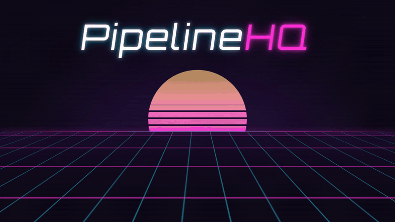
</a>

**▶ [Watch the full teaser with sound (67 s, 1080p)](docs/media/pipelinehq-teaser.mp4)**

[See it in action](#-see-it-in-action) · [Features](#-everything-a-revenue-team-needs) · [Quick start](#-quick-start-5-minutes) · [Deploy](#-deploy) · [Architecture](#-architecture) · [API](#-api-map)

</div>

---

## Why PipelineHQ?

Most CRMs are either spreadsheets with a login or enterprise suites that take a quarter to configure. PipelineHQ covers the middle ground: the object model sales teams already know (**Lead → Account → Contact → Opportunity**), plus the parts that actually drive revenue:

- 🎯 **Process that's enforced, not suggested.** MEDDIC stage gates are validated by the API, so a deal can't skip to Proposal without a champion and a pain.
- ⚡ **One-click conversion.** A qualified lead becomes an Account, Contact and Opportunity in a single database transaction.
- 📈 **Forecast you can trust.** Commit, best case and pipeline roll-ups, deal health scoring and stale-deal detection.
- 🤖 **Coaching built in.** AI assists summarize deals, suggest the next best action and draft emails (rules engine offline, optional LLM).
- 👥 **Built for the whole team.** Separate workspaces for **Sales Development**, **Account Executives** and **Sales Managers**.
- 📱 **Your pipeline in your pocket.** A native **Telegram Mini App** for checking KPIs and moving deals from your phone.

Every GIF below is a **real, unedited recording of the running app** with seeded demo data, so you can see how PipelineHQ works before installing anything.

---

## 🎬 See it in action

### 1. Live revenue dashboard
One-click demo login drops you into a role-scoped command center with open pipeline, at-risk dollars, stale deals, win/loss, conversion funnel and pipeline by stage. Toggle 7 / 30 / 90-day ranges, and results are cached in Redis.

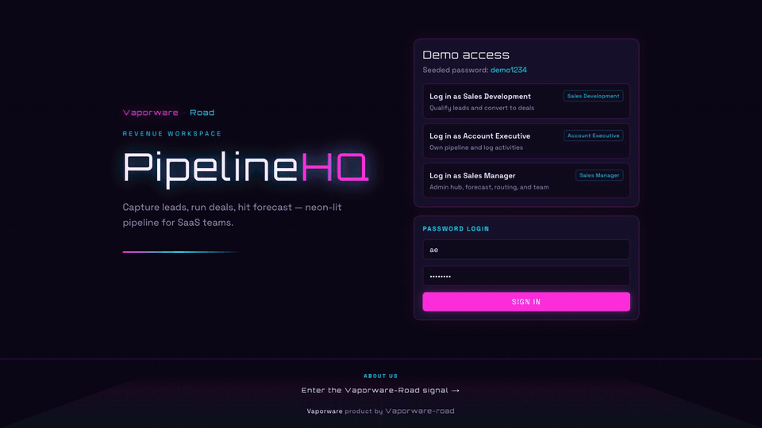

### 2. Capture a lead → convert it to a deal
Create a lead (or bulk-import CSV on a Celery worker), and leads get auto-scored and round-robin routed. **Convert** creates the Account, Contact and Opportunity atomically and opens the new deal.

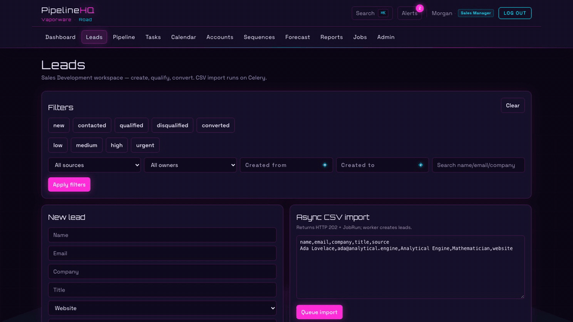

### 3. Pipeline board with MEDDIC stage gates
Filter by rep, forecast category, health, amount or close date. Try to jump an unqualified deal to **Proposal** and the API blocks it. Legit moves go through, and closing a deal requires a win/loss reason.

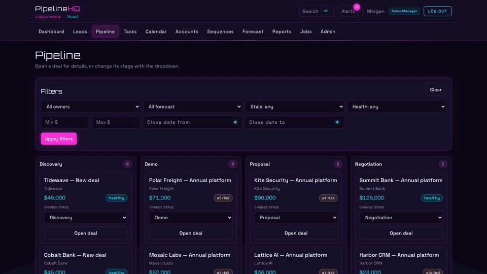

### 4. Deal room: AI assists + MEDDIC checklist
Get a suggested next step and an instant deal summary, then fill in the MEDDIC checklist. Once the economic buyer is in, the deal can advance to **Negotiation**.

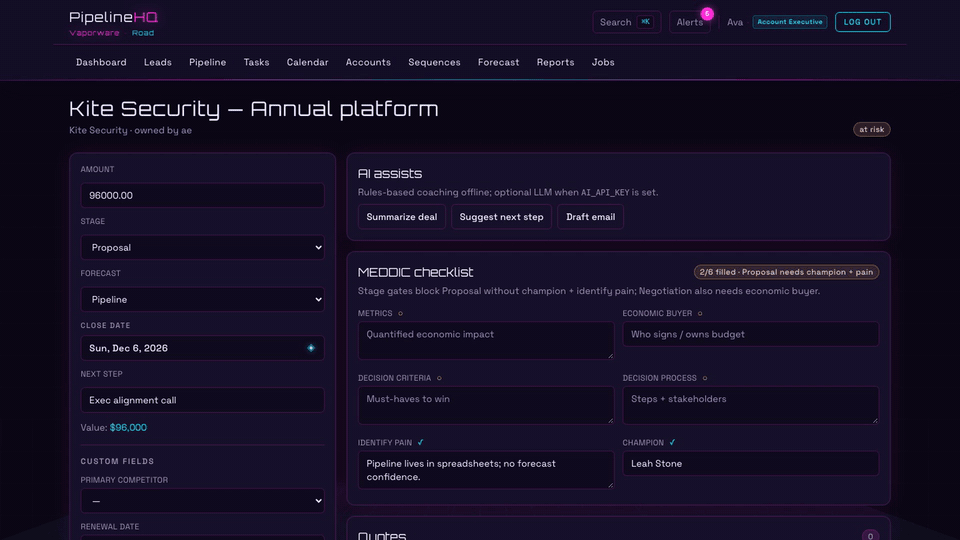

### 5. Team collaboration with @mentions
Comment on deals with `@ROLE` or `@@username` autocomplete. Mentioned teammates get real-time alerts over WebSockets.

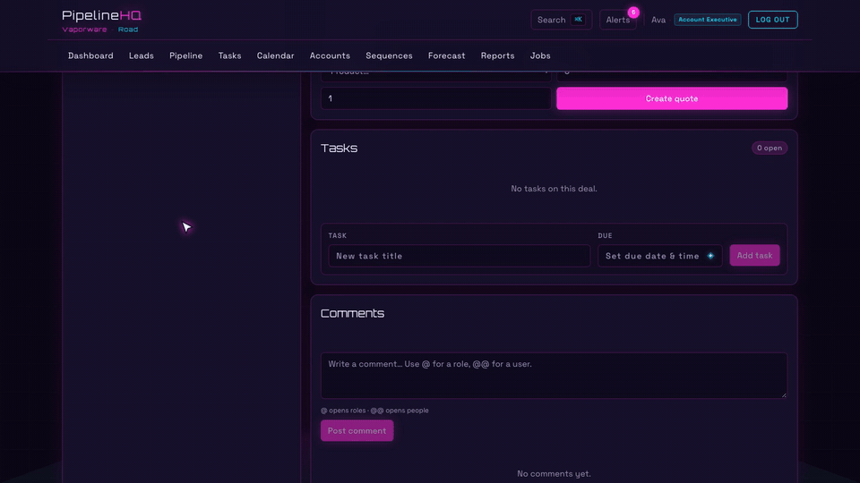

### 6. Alerts + ⌘K global search
A live notification inbox, and **⌘K / Ctrl+K** search across leads, accounts, contacts and deals with keyboard navigation.

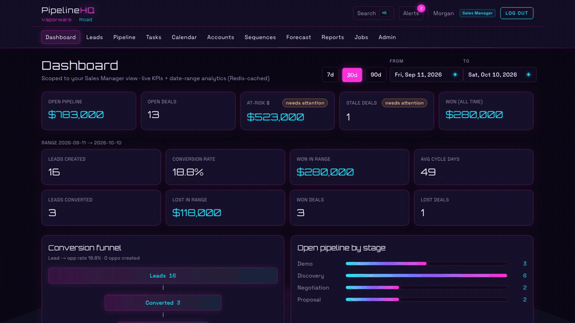

### 7. Reports, forecast & async exports
Date-ranged funnel, activity mix and per-rep activity. Forecast roll-ups by owner. CSV exports run on **Celery**, and you can watch the job finish on the Jobs page.

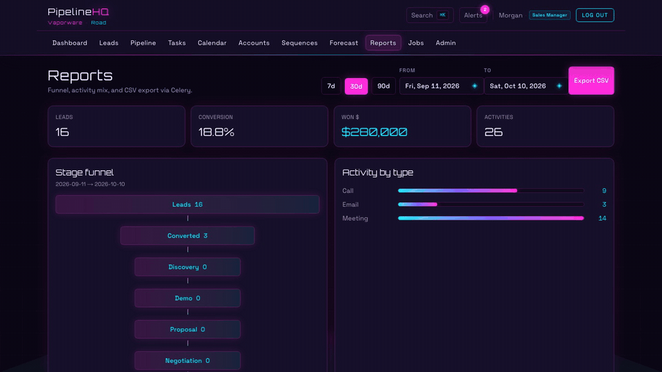

### 8. Admin hub for Sales Managers
Manage the team and roles, lead routing rules, custom fields, territories, the audit log and one-click operations (stale scan, cache warm, sequence advance, demo reset).

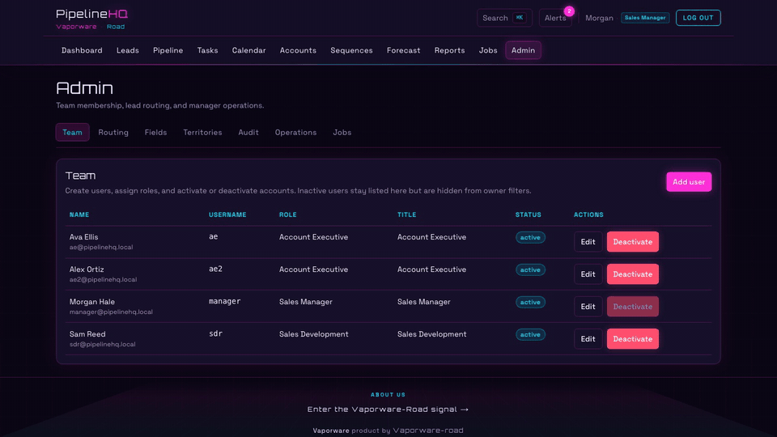

### 9. Calendar, meetings & tasks
Week calendar with meeting details, public booking links and availability slots, plus task lists (Mine / Overdue / All) tied to leads and deals.

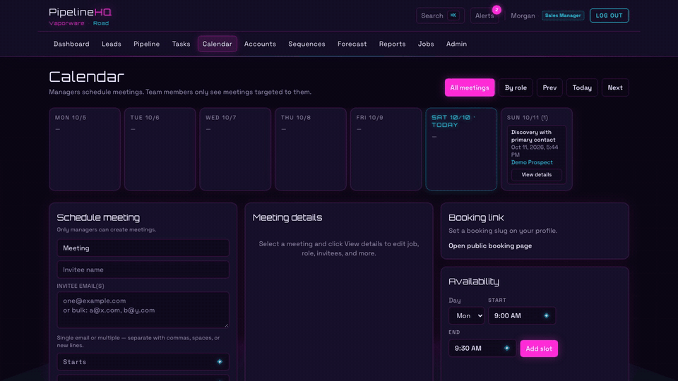

### 10. Telegram Mini App
The same CRM, built for thumbs: KPIs, pipeline by stage, deals, leads, schedule and clients. Change a deal stage in two taps. → [Setup guide](./TELEGRAM.md)

<p align="center">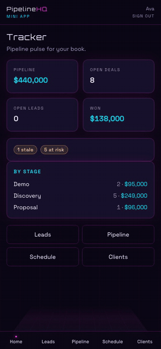</p>

---

## ✨ Everything a revenue team needs

| Area | What you get |
|------|--------------|
| **Leads** | Create, CSV import (async), multi-filters, priority, lead scoring, duplicate detection & merge, round-robin routing, sequence enrollment |
| **Customers** | Accounts & contacts, territories, custom fields (EAV), unified activity timeline, merge duplicates |
| **Pipeline** | Kanban-style stages, filters (owner / forecast / stale / health / amount / dates), win/loss reasons, deal health & stale scanning |
| **Process** | MEDDIC checklist with **API-enforced stage gates**, audit log |
| **Deals** | Quotes (CPQ-lite) with manager approval over a discount threshold, tasks, activities, tracked emails (open/click) |
| **AI assists** | Deal summary, next best action, email drafts. Works offline via rules, with an optional OpenAI-compatible LLM overlay |
| **Collaboration** | Comments & replies, `@role` / `@@user` mentions, real-time notifications (Django Channels) |
| **Engagement** | Email templates & multi-step sequences advanced by Celery Beat |
| **Scheduling** | Meetings, calendar, availability slots, public booking page `/book/<slug>` |
| **Analytics** | Dashboard KPIs, conversion funnel, activity reports, forecast (commit / best case / pipeline), CSV exports |
| **Admin** | Users & roles, routing rules, custom fields, territories, audit, ops jobs, job monitor |
| **Mobile** | Telegram bot + Mini App with Telegram-signed auth and account linking |

**Three roles, three workspaces:**

| Role | Job to be done |
|------|----------------|
| **Sales Development** | Own leads, qualify, convert → Account + Contact + Opportunity |
| **Account Executive** | Run the pipeline, log activity, fill MEDDIC, close with win/loss reasons |
| **Sales Manager** | Admin hub (team, roles, routing, ops), forecast, reports and exports |

---

## 🧱 Tech stack

| Layer | Choice |
|-------|--------|
| API | Django 5.2, Django REST Framework, SimpleJWT, django-filter |
| Realtime | Django Channels + Daphne (ASGI), Redis channel layer |
| Jobs | Celery worker + Celery Beat (django-celery-beat), Redis broker |
| Data | PostgreSQL 16 |
| Cache | Redis (dashboard + analytics) |
| UI | Next.js 15 (App Router), React 19, TypeScript, Tailwind CSS 4 |
| Mobile | Telegram Bot (python-telegram-bot) + Telegram Mini App |
| Ops | Docker Compose: `db`, `redis`, `web`, `worker`, `beat`, `telegram-bot`, `frontend` |

---

## 🚀 Quick start (5 minutes)

### Option A: Docker Compose (recommended)

```bash
git clone https://github.com/Vaporware-road/PipelineHQ.git
cd PipelineHQ
docker compose up --build
```

On start-up, the `web` service migrates the database, **seeds demo data** and registers periodic tasks.

- UI → **http://localhost:3000**
- API → **http://localhost:8000/api/**

Click a **Demo access** button on the login page and you're in.

### Option B: Run locally

**Prerequisites:** Python 3.12+, Node 20+, PostgreSQL, Redis.

```bash
# 1) Python env
python -m venv .venv
source .venv/bin/activate          # Windows: .venv\Scripts\activate
pip install -r requirements.txt
cp .env.example .env               # adjust DB / Redis if needed

# 2) Database + demo data
cd backend
python manage.py migrate
python manage.py seed_demo --reset
python manage.py setup_periodic_tasks
cd ..

# 3) Frontend deps
cd frontend && npm install && cd ..

# 4) Run everything (API + worker + beat + UI)
./scripts/dev.sh
```

Or start each process yourself:

```bash
cd backend && daphne -b 127.0.0.1 -p 8000 config.asgi:application   # API + WebSockets
cd backend && celery -A config worker -l info                        # imports, exports, emails
cd backend && celery -A config beat -l info                          # stale scan, sequences, overdue tasks
cd frontend && npm run dev                                           # UI on :3000
```

### Demo logins

All seeded users share the password **`demo1234`**. You can also use the one-click **Demo access** buttons.

| Username | Role |
|----------|------|
| `sdr` | Sales Development |
| `ae` | Account Executive |
| `ae2` | Account Executive |
| `manager` | Sales Manager |

**Suggested 3-minute tour:**
1. **Sales Manager:** Dashboard → Pipeline (filter by `ae2`) → Reports → Forecast → *Export CSV* → Jobs → Admin.
2. **Account Executive:** ⌘K search → open a deal → *Suggest next step* → fill MEDDIC → move to Negotiation → comment `@@manager`.
3. **Sales Development:** Leads → create a lead → check Tasks and the Alerts bell.

---

## 🌍 Deploy

PipelineHQ is a standard **ASGI Django + Next.js** app, so it runs anywhere you can run containers or processes: a VPS (Hetzner, DigitalOcean, Lightsail), Render, Railway, Fly.io or Kubernetes.

### Services you need

| Process | Command | Notes |
|---------|---------|-------|
| **API (ASGI)** | `daphne -b 0.0.0.0 -p 8000 config.asgi:application` | Serves REST + WebSockets (`/ws/realtime/`) |
| **Worker** | `celery -A config worker -l info` | CSV import/export, emails, sequences, ops jobs |
| **Scheduler** | `celery -A config beat -l info` | Stale-deal scan, sequence advance, overdue tasks |
| **Frontend** | `npm run build && npm run start` | Next.js on port 3000 |
| **Telegram bot** *(optional)* | `python manage.py run_telegram_bot` | Only if `TELEGRAM_BOT_TOKEN` is set |
| **PostgreSQL 16** | managed DB or container | |
| **Redis 7** | managed or container | Cache, Celery broker, Channels layer |

Run once per release:

```bash
cd backend
python manage.py migrate
python manage.py setup_periodic_tasks
python manage.py collectstatic --noinput   # Django admin assets → backend/staticfiles
# optional, demo environments only:
python manage.py seed_demo
```

### Production environment

Copy `.env.example` and set at least:

```bash
DJANGO_DEBUG=0
DJANGO_SECRET_KEY=<long random string>
DJANGO_ALLOWED_HOSTS=crm.example.com,api.crm.example.com
CORS_ALLOWED_ORIGINS=https://crm.example.com

POSTGRES_DB=pipelinehq
POSTGRES_USER=pipelinehq
POSTGRES_PASSWORD=<strong password>
POSTGRES_HOST=<db host>

REDIS_URL=redis://<redis-host>:6379/0
CELERY_BROKER_URL=redis://<redis-host>:6379/0
CHANNEL_LAYER_URL=redis://<redis-host>:6379/1

PUBLIC_BASE_URL=https://api.crm.example.com      # used for email tracking links

# Frontend (build-time)
NEXT_PUBLIC_API_URL=                              # empty = same-origin /api via Next rewrite
API_PROXY_TARGET=http://web:8000                  # where Next forwards /api
NEXT_PUBLIC_WS_URL=wss://api.crm.example.com      # WebSocket origin

# Optional: SMTP, AI and Telegram (see .env.example)
```

> `NEXT_PUBLIC_*` values are baked in at `npm run build`, so rebuild the frontend after changing them.

### Option 1: Single VPS with Docker Compose

1. Install Docker on the server, then clone the repo and create `.env` with the production values above.
2. The bundled `docker-compose.yml` is **development-oriented**: it bind-mounts source, runs `next dev` and seeds demo data. For production, change the following, for example in a `docker-compose.prod.yml` override:
   - `web`: replace the command with `migrate && collectstatic && daphne …` (drop `seed_demo`), set `DJANGO_DEBUG=0`, remove the source volume.
   - `frontend`: run `npm run build && npm run start` instead of `npm run dev`.
   - `db` / `redis`: don't publish ports `5432` / `6379` publicly, and use a strong DB password.
3. Put a TLS reverse proxy in front. Example **Caddyfile**, with automatic HTTPS and WebSocket support:

   ```caddyfile
   crm.example.com {
       reverse_proxy frontend:3000
   }
   api.crm.example.com {
       handle_path /static/* {
           root * /srv/staticfiles
           file_server
       }
       reverse_proxy web:8000        # REST, /admin and /ws/realtime/
   }
   ```

4. Start everything with `docker compose -f docker-compose.yml -f docker-compose.prod.yml up -d --build`.

### Option 2: PaaS (Render / Railway / Fly.io)

- Create a **PostgreSQL** and a **Redis** add-on.
- Create **3 services from `Dockerfile.backend`** (`web`, `worker`, `beat`) with the start commands from the table above, and give `web` a release command of `python manage.py migrate && python manage.py setup_periodic_tasks`.
- Create **1 service from `frontend/Dockerfile`** with the start command `npm run build && npm run start` (or deploy `frontend/` to **Vercel** and point `API_PROXY_TARGET` at your API URL).
- Set the environment variables above on every backend service.

### Telegram Mini App (optional)

Create a bot with **@BotFather**, set `TELEGRAM_BOT_TOKEN`, `TELEGRAM_BOT_USERNAME`, `NEXT_PUBLIC_TELEGRAM_BOT_USERNAME` and `TELEGRAM_WEBAPP_URL=https://crm.example.com/tma`, then run the `telegram-bot` service. The full walkthrough is in **[TELEGRAM.md](./TELEGRAM.md)**.

### Production checklist

- [ ] `DJANGO_DEBUG=0` and a unique `DJANGO_SECRET_KEY`
- [ ] Demo users removed or passwords changed (don't run `seed_demo` in production)
- [ ] HTTPS everywhere; reverse proxy forwards WebSocket upgrades for `/ws/realtime/`
- [ ] DB and Redis not exposed to the internet; automated Postgres backups
- [ ] Worker **and** beat running (exports, sequences and alerts depend on them)
- [ ] SMTP configured (`EMAIL_BACKEND`, `EMAIL_HOST`, …) if you send emails

---

## 🏗 Architecture

```text
 Browser / Telegram Mini App (Next.js 15)
          │  JSON + JWT            ▲  WebSocket (live alerts, timeline)
          ▼                        │
 Django REST API + Channels (Daphne, ASGI) ──► PostgreSQL
          │
          ├─► Redis  (cache · Channels layer)
          │
          └─► Redis broker ──► Celery worker  (imports · exports · emails · ops)
                                   ▲
                              Celery Beat  (stale scan · sequences · overdue tasks)
```

HTTP stays fast because heavy work (CSV imports and exports, emails, sequence steps, stale scans, demo reset) runs in Celery, and the Jobs page tracks it live.

### Project layout

```text
.
├── backend/
│   ├── config/            # settings, ASGI/WSGI, Celery app, URLs
│   └── apps/
│       ├── accounts/      # users, roles, JWT auth, profile
│       ├── crm/           # leads, accounts, deals, MEDDIC, analytics, AI assists, realtime
│       └── telegram/      # bot, Mini App auth, alerts
├── frontend/              # Next.js App Router UI (+ /tma Telegram Mini App)
├── docs/media/            # teaser + feature GIFs used in this README
├── docker-compose.yml
├── Dockerfile.backend
└── requirements.txt
```

---

## 🔌 API map

| Method | Path | Notes |
|--------|------|-------|
| POST | `/api/auth/token/` | JWT username/password |
| POST | `/api/auth/demo-login/` | `{ "role": "SDR\|AE\|MANAGER" }` |
| GET/PATCH | `/api/auth/me/` | Current user / self profile update |
| POST | `/api/auth/change-password/` | Self password change |
| GET | `/api/auth/me/summary/` | Personal workspace counts |
| CRUD | `/api/auth/users/` | Sales Manager team admin |
| GET | `/api/search/?q=` | Global search |
| CRUD | `/api/leads/` | Convert, CSV import, multi-filters |
| CRUD | `/api/accounts/`, `/api/contacts/` | |
| CRUD | `/api/opportunities/` | Pipeline, comments, amount/date filters |
| CRUD | `/api/activities/`, `/api/tasks/` | `?mine=1`, `?overdue=1` |
| GET | `/api/dashboard/` | Redis-cached KPIs |
| GET/POST | `/api/analytics/<overview\|funnel\|activity\|export>/` | Date-ranged analytics |
| GET/POST | `/api/forecast/` | Manager CSV export |
| GET | `/api/notifications/` | Inbox + mark-read |
| GET/PATCH | `/api/routing-rules/` | Lead routing |
| CRUD | `/api/sequences/`, `/api/sequence-enrollments/`, `/api/email-templates/` | |
| GET | `/api/jobs/` | Celery job status |
| POST | `/api/ops/<action>/` | `stale-scan`, `warm-cache`, `reset-demo`, `advance-sequences` |
| WS | `/ws/realtime/?token=<jwt>` | Live notifications & timeline events |

Telegram endpoints are documented in [TELEGRAM.md](./TELEGRAM.md).

---

## 🧪 Tests

```bash
cd backend
python manage.py test
```

The test suite covers lead conversion, MEDDIC gates, mentions, analytics, quotes and scoring, custom fields and territories, AI assists and realtime, and Telegram auth and alerts.

---

## 📚 More docs

- [LEARNING.md](./LEARNING.md): a deep dive into the design decisions
- [TELEGRAM.md](./TELEGRAM.md): Telegram bot & Mini App setup
- [miniAppDashboard.md](./miniAppDashboard.md): Mini App screens
- [managementPlan.md](./managementPlan.md): Profile + Admin hub plan

---

<div align="center">

**Built by [Vaporware-Road](https://github.com/Vaporware-road).** If PipelineHQ helps you or inspires you, **⭐ star the repo**. It really helps.

<sub>The teaser soundtrack is an original synthwave piece composed for this project. Demo credentials are for local evaluation only, so never reuse them in production.</sub>

</div>
